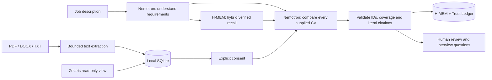

# TalentLens

**Find talent. See why.** TalentLens is a multilingual CV discovery workspace that connects job requirements with documented candidate experience. NVIDIA Nemotron interprets the role and CVs and proposes candidates with source citations. A recruiter verifies the evidence and decides the next step.

The application has no keyword compatibility engine, local candidate scoring, percentages or automatic hiring/rejection decisions.

## Quick start

Requires **Node.js 22.16 or later** and npm. Node 22 is recommended.

```powershell
cd hackaton
npm.cmd ci
npm.cmd run setup
npm.cmd start
```

Open [TalentLens](http://127.0.0.1:4317). On Windows, you can also double-click `START-TALENTLENS.cmd`. Stop the server with Ctrl+C. The server binds to the local computer only. Node 22 may display an experimental warning for its built-in SQLite module.

Without API credentials, you can create roles, upload/view CVs and load three clearly fictional sample profiles. Sample content contains no fabricated AI results.

## Languages

The flag selector in the top bar switches between **English, Spanish, French and German**. English is the initial language. Your selection is remembered locally; `?lang=en`, `?lang=es`, `?lang=fr` and `?lang=de` also select a language explicitly.

Navigation, illustrations, forms, validation, API errors, connection states, sample content, dates and report export labels are localized. Nemotron is instructed to write every narrative field in the selected language. Existing reports can be translated through the active AI provider after explicit consent, and translations are cached locally. Translation preserves candidate IDs, ordering, recommendations, evidence statuses and original quotations.

Uploaded CVs, recruiter notes, company names and other user-provided content retain their original language. Source quotations are never translated: they remain verifiable against the exact document used for the report. The built-in fictional CVs and sample role have curated versions in all four languages.

## Connect NVIDIA Nemotron

For the hackathon, connect Nemotron **through Meterless Nightshift**. The [Official Rules updated on 22 October](https://hackathon.genai.works/resources?id=01a08ff1-54cc-709a-bfe7-6b34452b676b) require Nightshift as the primary AI provider and at least one working Meterless Engine. Cursor is optional; any AI coding tool is permitted.

1. Sign in to the [Nemotron 3.5 Super VL model page](https://build.nvidia.com/nvidia/nemotron-3.5-super-vl-120b-a12b) and choose **Generate API Key**.
2. If that button does not open the key dialog, use [NVIDIA NGC API Keys](https://org.ngc.nvidia.com/account/api-keys): sign in, generate a personal key and enable **NVIDIA Public API Endpoints**. Follow the [official NGC guide](https://docs.nvidia.com/ngc/latest/ngc-user-guide.html).
3. Save the key in **Nightshift → Providers**. For the text-CV workflow, select `nvidia/nemotron-3.5-lightning-30b-a3b` and verify which model actually handles a request. The NVIDIA API key is account-based; changing the selected model does not require sharing an account or creating another key.
4. Configure TalentLens with the Nightshift URL, runtime token and routing model below. Do not put the NVIDIA key in the application settings for the submitted workflow.

In **Connections**, test the active provider. Then open a role, consent to sending its documents and run an analysis. Endpoint availability and usage quotas depend on NVIDIA. `.env`, local data and dependencies are excluded from Git. The existing direct NVIDIA adapter is a development option and does not demonstrate the required Nightshift integration.

## Connect Meterless Nightshift

TalentLens implements the [official OpenAI-compatible Nightshift provider contract](https://github.com/Meterless/Meterless/blob/main/docs/agent-ready/add-meterless-provider.md): URL normalization, real bearer authentication, `meterless-app: talentlens`, `meterless-scope: user`, routing model IDs and a 180-second request timeout.

Install and start [Nightshift](https://meterless.ai/windows.html), save your own NVIDIA key in its Providers settings, then run `npm run setup` to import the runtime token from this computer. Keep Nightshift running while using TalentLens. Nightshift 1.2.1 advertises concrete model IDs alongside routing modes:

```dotenv
AI_PROVIDER=meterless
METERLESS_BASE_URL=http://127.0.0.1:8088/v1
METERLESS_RUNTIME_TOKEN=the-real-token-from-your-runtime
METERLESS_MODEL=nvidia/nemotron-3.5-lightning-30b-a3b
```

Nightshift stores its token at `<stateDir>/proxy-token`. The placeholder `rt-local` is rejected. Use a model or route listed by your runtime. Connection checks authenticate against `/v1/models`, distinguish unauthorized/offline/online states and send no CVs. `npm run doctor` also checks that the selected model is advertised. `npm run doctor -- --infer` adds one small JSON inference without CVs and reports the actual model from Nightshift's response.

**Nightshift 1.2.1 routing caveat:** an application's saved routing profile can override a concrete requested model. In Nightshift's compute sources, enable the intended Nemotron and disable NVIDIA models your account cannot run. Preserve privacy and verification settings. TalentLens refuses a response if Nightshift does not confirm the selected concrete NVIDIA model, and saves actual model/receipt IDs with successful reports. A successful model-catalog check alone does not prove inference or routing.

The verified configuration uses the **fast** application profile in Nightshift with only the selected Nemotron enabled. This profile change preserves privacy and verification settings. TalentLens requests a structured, side-effect-free result tool, so its own two-stage recruiting workflow does not trigger Nightshift's extra code-planning generation when CVs mention programming languages. Streaming avoids the runtime's 45-second wait for buffered provider headers. The adapter accepts Nightshift 1.2.1's complete tool-call deltas as well as incremental OpenAI deltas, bounds the stream to 4 MB, discards reasoning, and refuses incomplete or review-gated responses.

**Live verification passed on 22 October 2026:** three fictional CVs were retrieved from Zetaris and analysed through Nightshift by `nvidia/nemotron-3.5-lightning-30b-a3b`; both actual model IDs and receipt IDs were confirmed. Every candidate and requirement was covered and every source quotation passed validation. The successful run used two model calls.

NVIDIA currently advertises this hosted inference catalog as [free for development](https://build.nvidia.com/). This setup uses that endpoint and does not provision paid GPU infrastructure or subscribe to a plan. Trial availability and request limits are controlled by NVIDIA. Running Nightshift locally still uses the computer's resources.

After setting up the fictional Zetaris sources, `npm run verify:live` exercises the actual Zetaris → Nightshift → Nemotron path. It checks every imported field against the three public fictional fixtures **before** sending anything to AI, validates all report citations, and writes a successful report plus execution IDs to ignored `data/live-verification.json`. Additional or changed database records stop the check without sending CVs. This command makes real provider requests and requires available quota; CI uses mocks instead.

## Meterless H-MEM

TalentLens implements the official Meterless H-MEM contract as a persistent SQLite-backed evidence graph. After Nemotron extracts a role's requirements, H-MEM performs the canonical hybrid retrieval across earlier hiring processes, limited to the configured organization and authorised candidates. Only current memories whose original literal quote is still verifiable are passed to Nemotron. Validated current-document evidence becomes deduplicated long-term memory with candidate, document and version lineage plus Trust Ledger audit.

CV updates create new document versions and place older facts into pending verification before reuse. Cumulative facts can supersede earlier versions; incompatible claims are excluded and queued for human resolution. Candidate/fact deletion, source invalidation, feedback, retrieval traces and a compact UI are included. See [H-MEM integration and three-minute demo](docs/HMEM-INTEGRATION.md).

## Connect Zetaris

The event's current [Zetaris setup repository](https://github.com/zetaris/getting-started) uses a local Docker installation with Lightning JDBC and REST access. Obtain the platform bundle, matching configuration and registry credentials from [Zetaris Cloud](https://cloud.enterprise.zetaris.com), then follow its [local installation guide](https://github.com/zetaris/getting-started/blob/main/docs/install/updated_zetaris_installation_guide.md). The platform distribution and evaluation entitlement are separate from the open-source recipes. On Windows, the guide uses WSL2 with Docker Desktop integration.

TalentLens uses the bundle's **Lightning REST API**, following Zetaris's [official REST channel implementation](https://github.com/zetaris/getting-started/blob/main/scripts/zetaris_sql.py). Configure a dedicated read-only API key and an authorised candidate view with these columns:

| Column | Content |
| --- | --- |
| `candidate_id` | Stable candidate identifier |
| `display_name` | Display name |
| `document_name` | CV filename |
| `cv_text` | Extracted CV text |

```dotenv
ZETARIS_REST_URL=http://localhost:8888/api/v1.0
ZETARIS_ORG_ID=your-numeric-organization-id
ZETARIS_API_KEY=your-own-read-only-key
ZETARIS_TABLE=talentlens.candidates
```

Choose **Connections → Import from Zetaris**. The adapter calls `/api/v1.0/sql-editor/sqls/run` with bearer authentication, `X-Org-ID`, a unique `X-Request-ID`, fixed selected columns and `LIMIT 25`. It sends only SELECT queries, rejects redirects and malformed/oversized row sets, and applies a 30-second timeout. A remote connection requires HTTPS. `npm run doctor` verifies `SELECT 1` separately from the candidate-view import; an online database does not establish that the view exists or has permission to be read. Local uploads do not demonstrate use of Zetaris as the data layer.

The [reproducible fictional sources](examples/zetaris/README.md) contain two CSV sources and the join-view SQL. Creating the view, granting a separate GENERAL user SELECT on that view, and importing its three CVs through the application all passed against a real local Zetaris installation on 22 October 2026. Set `ZETARIS_SYNTHETIC=true` only when using these fictional sources.

## Working as a team

Each developer uses their own NVIDIA key, Nightshift token and Zetaris access. Do not share Google accounts, passwords, the local `.env`, the Zetaris distribution or personal image-registry credentials. The repository contains only configuration templates. See [team setup](docs/TEAM-SETUP.md) for the full workflow, including separate users on a shared Zetaris instance.

## Architecture



Analysis has two stages: requirement extraction and candidate comparison. The app validates output structure, coverage and exact source quotations, preserving the model’s recommendation order. If a stage fails citation validation, the model gets one correction attempt; the full result must pass the same validator. No evidence is repaired or silently discarded by application code. There are at most four model calls and no automatic retry of provider/network failures. Reports retain the job description and CV text they used. These checks provide traceability; they do not establish the truth of a CV or guarantee a correct, unbiased recommendation.

Roles, versioned document text, source snapshots, reports, translations, H-MEM records/traces/ledger and human review states persist in `data/talentlens.sqlite`. The application automatically migrates the previous database filename without discarding records. Original upload binaries are not retained.

## Scope and limits

- Single-user local prototype with one configured organization per process; no production user authentication or remote hosting.
- Up to 25 CVs, 10 files per import, 5 MB per file, 40,000 characters per CV and 200,000 characters per analysis. Oversized inputs are rejected without silent truncation.
- Text-based PDFs up to 50 pages; scanned PDFs need OCR first. DOCX reads main text, tables, headers and footers, with archive/XML limits and no DTDs.
- Parsing uses separate child processes with a 128 MB JavaScript heap budget and a 20-second timeout. This is not an OS-level security sandbox or a hard native-memory cap.
- Model requests and report translations require explicit consent. Use fictional CVs for demonstrations and check the provider’s data terms before real CVs.
- Prompts instruct the model to ignore embedded document instructions and protected attributes. Prompt injection resistance and fairness require further evaluation.
- Live services require each developer's credentials. Verified connection checks and the Zetaris import do not establish that the full AI workflow or all hackathon requirements have passed; see the delivery status below.

## Validation

```powershell
npm.cmd run check
npm.cmd test
npm.cmd run test:hmem:conformance
npm.cmd audit
```

Tests cover PDF/DOCX/TXT parsing, invalid inputs, origin controls, consent, evidence validation, locale completeness and parameters, selected model language, translation integrity/cache, localized exports, database migration, provider authentication, the Zetaris Lightning REST contract, H-MEM persistence/retrieval/versioning/conflicts/privacy and the official H-MEM conformance suite. Automated tests mock external services; live checks are reported separately. CI runs the same checks and a credential scan without personal API keys.

See [submission notes](docs/SUBMISSION.md) for project provenance, sponsor contribution and verified delivery status.
