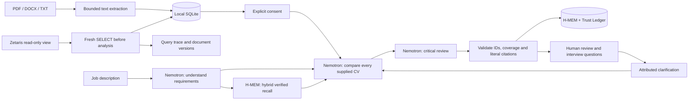

# TalentLens

**Find talent. See why.** TalentLens connects each job requirement to inspectable evidence, identifies the next question to clarify and shows what changes when a recruiter records a new source. NVIDIA Nemotron interprets the role, drafts a comparison and critically reviews its claims. The recruiter decides the next step.

The application has no keyword compatibility engine, local candidate scoring, percentages or automatic hiring/rejection decisions.

## Explore without accounts or API keys

**Judges: start with the [step-by-step walkthrough](docs/JUDGES.md) and [paired sample inputs/outputs](examples/judges/README.md). No demo login is required.**

With Git and Node.js 22.16+ installed:

```sh
git clone https://github.com/oveun-software/hackaton.git
cd hackaton
npm run demo
```

Open **http://127.0.0.1:4319/showcase.html?lang=en**. On Windows PowerShell, use `npm.cmd` if script execution is restricted. No dependency installation, `.env`, Docker or sponsor account is needed for this static viewer. It shows **recorded real Nemotron executions with fictional profiles**, in English, Spanish, French and German. It makes no inference calls. This is the sample/fallback mode; generating a new analysis requires the live services described below.

The three steps show the original evidence, a documented clarification and another role retrieving earlier context after restart. Open any matrix cell to inspect the quotation and source. The live application also links to this viewer. Choose **Try a guided CV review** for two timed rounds (manual and assisted), four fictional profiles per round, recorded answers and a downloadable session result. [All 16 fictional CV files](examples/pilot/README.md) are included. No recruiter sessions or productivity gains have been fabricated.

## Evidence review and quality checks

- Atomic requirements, a comparison matrix and direct access to source text with the quoted passage highlighted.
- A second Nemotron review checking unsupported claims, negations, contradictions and evidence gaps; unresolved rows include a concrete question.
- Attributed clarification sources, reanalysis and an explicit comparison with the prior report. Candidate statements remain labelled as statements, not independently verified facts.
- Memory with source type, date, provenance and human conflict resolution. Repeating an analysis cannot reactivate a disputed memory.
- **44 automated tests and 13/13 official H-MEM checks.** A real model evaluation matched **32/32 authored evidence expectations across 16 fictional cases**, with zero unsupported positive assessments in that set. This is a small diagnostic evaluation, not a general accuracy or fairness guarantee. The critical review made no evidence-state/citation changes in that evaluation run; no incremental quality gain is claimed.

See [evidence review](docs/EVIDENCE-REVIEW.md), [evaluation results](evaluation/results.json), [evaluation methodology](evaluation/README.md), and the [guided fictional-CV pilot](evaluation/RECRUITER-PILOT.md).

### Sample inputs and matching outputs

| Context | Input | Real output |
| --- | --- | --- |
| Frontend engineer: experience, interest, negation and a CV instruction attack | [English job + four CVs](examples/judges/frontend/input.json) | [Report + model/receipt records](examples/judges/frontend/output.json) |
| Quality engineer: manual/automated testing and conflicting sources | [English job + four CVs](examples/judges/quality/input.json) | [Report + model/receipt records](examples/judges/quality/output.json) |
| Data analyst: SQL, spreadsheets and adjacent technologies | [English job + four CVs](examples/judges/data/input.json) | [Report + model/receipt records](examples/judges/data/output.json) |
| Engineering lead: responsibility and multilingual evidence | [English job + four CVs, one intentionally Spanish](examples/judges/leadership/input.json) | [English report + original quotes](examples/judges/leadership/output.json) |

All inputs are fictional and committed, along with [individual CV files](examples/pilot/README.md). These paired files export the saved evaluation, with no invented model outputs. Run `npm run test:recordings` after `npm ci` to check their integrity; `npm run evaluate` generates fresh results through your own configured Nightshift/Nemotron. [Full explanation and English reading aid for the Spanish case](examples/judges/README.md).

## Live application: download and configure

The live workspace requires **Node.js 22.16 or later** and npm. Node 22 is recommended. A fresh Nemotron analysis also requires the Nightshift desktop runtime to remain open. Local uploads, H-MEM and Nightshift can run without Docker. The local Zetaris installation uses Docker. **Zetaris integration remains required for the hackathon submission**; local-upload and recorded-sample modes are additional ways to test the product.

1. Clone and install the exact dependencies:

   ```powershell
   git clone https://github.com/oveun-software/hackaton.git
   cd hackaton
   npm.cmd ci
   ```

2. Install the current official [Nightshift Windows build](https://meterless.ai/windows.html), start it and add your own NVIDIA API key in **Nightshift → Providers**. Enable `nvidia/nemotron-3.5-lightning-30b-a3b` for the TalentLens application profile.

3. Import this computer's Nightshift runtime token into the private `.env` file:

   ```powershell
   npm.cmd run setup -- --refresh-token
   ```

   Run this command again whenever Nightshift rotates or replaces its runtime token. It never prints the token.

4. Prove that the runtime, credentials, selected model and one small inference all work before opening the application:

   ```powershell
   npm.cmd run doctor -- --infer
   ```

   Continue only when `ai.state` is `online`, `ai.modelAvailable` is `true` and `ai.inference` is `passed`. Zetaris is reported separately and is optional for a workflow based on uploaded files. Add `--require-zetaris` to also require a successful Zetaris `SELECT 1` connection check. That check does not verify the candidate view or full import; use `npm run verify:zetaris` for the fresh-query route or `npm run verify:review` for the full clarification/memory workflow.

5. Start TalentLens:

   ```powershell
   npm.cmd start
   ```

Open [TalentLens](http://127.0.0.1:4317). On Windows, you can also double-click `START-TALENTLENS.cmd`. Stop the server with Ctrl+C. The server binds to the local computer only. Node 22 may display an experimental warning for its built-in SQLite module.

Without live credentials, you can still create roles, upload and inspect CVs, load three clearly fictional sample profiles and use the recorded walkthrough. Generating a new report requires the live readiness check above.

## Use the live application

1. Open **CV library** and upload PDF, DOCX or TXT files, or choose **Use sample CVs**.
2. Open **Open roles**, create a role with a clear description or select the sample role.
3. Open **Connections** and choose **Test active connection**. A token labelled “configured” has not yet proved that Nightshift is running.
4. Return to the role and select **Workspace CVs · local mode** for those uploaded/sample files, or **Zetaris · fresh query** to query the configured view. Review the source scope, accept the explicit data-transfer consent and run the analysis.
5. Review every recommendation against its source quotation and H-MEM trace, record the human next step and use **New CV version** when a candidate updates a CV.

The `?` button in the top bar explains the workflow. Workspace mode includes every CV currently in the library; remove unrelated fictional records before demonstrating a different scenario. Zetaris mode includes only the latest query's returned candidates and shows their query/document trace.

## Languages

The flag selector in the top bar switches between **English, Spanish, French and German**. English is the initial language. Your selection is remembered locally; `?lang=en`, `?lang=es`, `?lang=fr` and `?lang=de` also select a language explicitly.

Navigation, illustrations, forms, validation, API errors, connection states, sample content, dates and report export labels are localized. Nemotron is instructed to write every narrative field in the selected language. Existing reports can be translated through the active AI provider after explicit consent, and translations are cached locally. Translation preserves candidate IDs, ordering, recommendations, evidence statuses and original quotations.

Uploaded CVs, recruiter notes, company names and other user-provided content retain their original language. Source quotations are never translated: they remain verifiable against the exact document used for the report. The built-in fictional CVs and sample role have curated versions in all four languages.

## Connect NVIDIA Nemotron

For the hackathon, connect Nemotron **through Meterless Nightshift**. The [Official Rules updated on 23 October](https://hackathon.genai.works/resources?id=01a08ff1-54cc-709a-bfe7-6b34452b676b) require Nightshift as the primary AI provider and at least one working Meterless Engine. Cursor is optional; any AI coding tool is permitted.

1. Sign in to the [Nemotron 3.5 Super VL model page](https://build.nvidia.com/nvidia/nemotron-3.5-super-vl-120b-a12b) and choose **Generate API Key**.
2. If that button does not open the key dialog, use [NVIDIA NGC API Keys](https://org.ngc.nvidia.com/account/api-keys): sign in, generate a personal key and enable **NVIDIA Public API Endpoints**. Follow the [official NGC guide](https://docs.nvidia.com/ngc/latest/ngc-user-guide.html).
3. Save the key in **Nightshift → Providers**. For the text-CV workflow, select `nvidia/nemotron-3.5-lightning-30b-a3b` and verify which model actually handles a request. The NVIDIA API key is account-based; changing the selected model does not require sharing an account or creating another key.
4. Configure TalentLens with the Nightshift URL, runtime token and routing model below. Do not put the NVIDIA key in the application settings for the submitted workflow.

In **Connections**, test the active provider. Then open a role, consent to sending its documents and run an analysis. Endpoint availability and usage quotas depend on NVIDIA. `.env`, local data and dependencies are excluded from Git. The existing direct NVIDIA adapter is a development option and does not demonstrate the required Nightshift integration.

## Connect Meterless Nightshift

TalentLens implements the [official OpenAI-compatible Nightshift provider contract](https://github.com/Meterless/Meterless/blob/main/docs/agent-ready/add-meterless-provider.md): URL normalization, real bearer authentication, `meterless-app: talentlens`, `meterless-scope: user`, routing model IDs and a 180-second request timeout.

Install and start [Nightshift](https://meterless.ai/windows.html), save your own NVIDIA key in its Providers settings, then run `npm.cmd run setup -- --refresh-token` to import the runtime token from this computer. Keep Nightshift running while using TalentLens. Install the current build shown on the official page rather than assuming the build used for a recorded verification is still the latest. Nightshift advertises concrete model IDs alongside routing modes:

```dotenv
AI_PROVIDER=meterless
METERLESS_BASE_URL=http://127.0.0.1:8088/v1
METERLESS_RUNTIME_TOKEN=the-real-token-from-your-runtime
METERLESS_MODEL=nvidia/nemotron-3.5-lightning-30b-a3b
```

Nightshift stores its token at `<stateDir>/proxy-token`. The placeholder `rt-local` is rejected. Use a model or route listed by your runtime. Connection checks authenticate against `/v1/models`, distinguish unauthorized/offline/online states, verify the selected model and send no CVs. TalentLens performs the same preflight before an analysis or translation, so an offline runtime, rejected token or missing model fails before any CV content is submitted. `npm.cmd run doctor -- --infer` adds one small JSON inference without CVs and reports the actual model from Nightshift's response.

**Nightshift routing caveat:** an application's saved routing profile can override a concrete requested model. In Nightshift's compute sources, enable the intended Nemotron and disable NVIDIA models your account cannot run. Preserve privacy and verification settings. TalentLens refuses a response if Nightshift does not confirm the selected concrete NVIDIA model, and saves actual model/receipt IDs with successful reports. A successful model-catalog check alone does not prove inference or routing.

The verified configuration uses the **fast** application profile in Nightshift with only the selected Nemotron enabled. This profile change preserves privacy and verification settings. TalentLens requests a structured, side-effect-free result tool, so its own three-stage recruiting workflow does not trigger Nightshift's extra code-planning generation when CVs mention programming languages. Streaming avoids the runtime's 45-second wait for buffered provider headers. The adapter accepts the complete tool-call deltas produced by the verified 1.2.1 build as well as incremental OpenAI deltas, bounds the stream to 4 MB, discards reasoning, and refuses incomplete or review-gated responses.

### Nightshift troubleshooting on Windows

Run these commands from PowerShell without copying or printing the token:

```powershell
& "$env:LOCALAPPDATA\Nightshift\cli\ns.cmd" status --json
& "$env:LOCALAPPDATA\Nightshift\cli\ns.cmd" discover --json
npm.cmd run setup -- --refresh-token
npm.cmd run doctor -- --infer
```

| Symptom | Meaning | Action |
| --- | --- | --- |
| Connections says Nightshift is unavailable | The configured runtime cannot be reached or did not return a valid model catalog | Start Nightshift and check `METERLESS_BASE_URL` (default `http://127.0.0.1:8088/v1`), then test again. Docker does not start Nightshift. |
| Credentials are rejected | `.env` contains a missing or stale runtime token | Keep Nightshift open, run the refresh-token setup command, restart TalentLens and test again. |
| Provider is online but the model is unavailable | `METERLESS_MODEL` is not present in `/v1/models` | Enable the model in Nightshift or select an advertised concrete model, then rerun the doctor. |
| A catalog check passes but inference fails | The NVIDIA key, quota or Nightshift route cannot complete a request | Inspect Nightshift Providers and enabled models, then use the doctor inference result as the gate. |
| Zetaris is unavailable but uploaded CVs work | The data service or Docker engine may be stopped | Local uploads remain available. Start Docker Desktop and the Zetaris stack to demonstrate the required sponsor integration. |

**Live verification passed on 22 October 2026:** three fictional CVs were retrieved from Zetaris and analysed through Nightshift by `nvidia/nemotron-3.5-lightning-30b-a3b`; both actual model IDs and receipt IDs were confirmed. Every candidate and requirement was covered and every source quotation passed validation. The successful run used two model calls.

NVIDIA currently advertises this hosted inference catalog as [free for development](https://build.nvidia.com/). This setup uses that endpoint and does not provision paid GPU infrastructure or subscribe to a plan. Trial availability and request limits are controlled by NVIDIA. Running Nightshift locally still uses the computer's resources.

After setting up the fictional Zetaris sources, `npm run verify:live` exercises the actual application API and Zetaris → Nightshift → Nemotron path. It checks every imported field against the three public fictional fixtures **before** inference, runs a role, restarts the app with the same isolated database and runs a different role. It requires verified earlier H-MEM evidence in the second comparison input, validates citations and actual model/receipt IDs, and writes successful evidence to ignored `data/live-verification-hmem.json`. The temporary database is separate from your normal workspace. Additional or changed database records stop the check without sending CVs. This command makes real provider requests and requires available quota; CI uses mocks instead. `npm run verify:live:single` retains the earlier one-role connector check. See [the submission package](submission/README.md) for the latest real-run outcome.

**Latest evidence review verification, 26 October:** `npm run verify:review` completed the before/after clarification workflow, restart, another role and a paired no-memory comparison. Ten model calls confirmed Nemotron Lightning and retained receipts. Sam’s TypeScript evidence changed from unclear to supported after an attributed answer. After restart, that source was available through H-MEM; the paired current-CV-only condition remained unclear. This is one stochastic comparison, not a general causal claim. [Recorded results](examples/zetaris/verified-review-workflow.json).

## Meterless H-MEM

TalentLens implements the official Meterless H-MEM contract as a persistent SQLite-backed evidence graph. After Nemotron extracts a role's requirements, H-MEM performs the canonical hybrid retrieval across earlier hiring processes, limited to the configured organization and authorised candidates. Only current memories whose original literal quote is still verifiable are passed to Nemotron. Validated current-document evidence becomes deduplicated long-term memory with candidate, document and version lineage plus Trust Ledger audit.

CV updates create new document versions and place older facts into pending verification before reuse. Cumulative facts can supersede earlier versions; incompatible claims are excluded and queued for human resolution. Candidate/fact deletion, source invalidation, feedback, retrieval traces and a compact UI are included. See [H-MEM integration and recorded demo](docs/HMEM-INTEGRATION.md).

## Connect Zetaris

The event's current [Zetaris setup repository](https://github.com/zetaris/getting-started) uses a local Docker installation with Lightning JDBC and REST access. Zetaris is the required sponsor data-layer integration; individual local-upload sessions can work while it is offline. Docker is not involved in Nightshift, local file uploads or H-MEM. Obtain the platform bundle, matching configuration and registry credentials from [Zetaris Cloud](https://cloud.enterprise.zetaris.com), then follow its [local installation guide](https://github.com/zetaris/getting-started/blob/main/docs/install/updated_zetaris_installation_guide.md). The platform distribution and evaluation entitlement are separate from the open-source recipes. On Windows, the guide uses WSL2 with Docker Desktop integration. Before troubleshooting Zetaris logs, confirm that Docker Desktop's Linux engine is running with `docker version` and `docker ps`.

TalentLens uses the bundle's **Lightning REST API**, following Zetaris's [official REST channel implementation](https://github.com/zetaris/getting-started/blob/main/scripts/zetaris_sql.py). Configure a dedicated read-only API key and an authorised candidate view with these columns:

| Column | Content |
| --- | --- |
| `candidate_id` | Stable candidate identifier |
| `display_name` | Display name |
| `document_name` | CV filename |
| `cv_text` | Extracted CV text |

```dotenv
ZETARIS_REST_URL=http://localhost:8888/api/v1.0
ZETARIS_ORG_ID=your-numeric-organization-id
ZETARIS_API_KEY=your-own-read-only-key
ZETARIS_TABLE=talentlens.candidates
```

For the sponsor workflow, open a role, select **Zetaris · fresh query**, grant consent and choose **Analyze from Zetaris**. Each run queries the view first and analyzes only its returned candidates. A failed or empty query stops this mode without substituting cached CVs. **Workspace CVs · local mode** remains available without Zetaris. The separate **Connections → Import from Zetaris** action still prepares a workspace without inference.

Each successful Zetaris report displays **Zetaris data access** above the matrix: SQL, UTC timing, row count/limit, client correlation IDs and exact document versions/hashes. The Markdown export includes the same trace. Read the [workflow, API and verification details](docs/ZETARIS-WORKFLOW.md). Run `npm run verify:zetaris` for a fresh one-role sponsor check with the public fictional fixtures. Historical recordings remain dated and are not presented as proof of this new route.

The query is bounded to 25 rows and may omit other candidates in a larger view; it is not an exhaustive database search. The adapter calls `/api/v1.0/sql-editor/sqls/run` with bearer authentication, `X-Org-ID`, a unique `X-Request-ID`, fixed selected columns and `LIMIT 25`. It sends only SELECT queries, rejects redirects and malformed/oversized row sets, and applies a 30-second timeout. A remote connection requires HTTPS. `npm run doctor` verifies `SELECT 1` separately from the candidate-view import; an online database does not establish that the view exists or has permission to be read. Local uploads do not demonstrate use of Zetaris as the data layer.

The [reproducible fictional sources](examples/zetaris/README.md) contain two CSV sources and the join-view SQL. Creating the view, granting a separate GENERAL user SELECT on that view, and importing its three CVs through the application all passed against a real local Zetaris installation on 22 October 2026. Set `ZETARIS_SYNTHETIC=true` only when using these fictional sources.

## Working as a team

Each developer uses their own NVIDIA key, Nightshift token and Zetaris access. Do not share Google accounts, passwords, the local `.env`, the Zetaris distribution or personal image-registry credentials. The repository contains only configuration templates. See [team setup](docs/TEAM-SETUP.md) for the full workflow, including separate users on a shared Zetaris instance.

## Architecture



Analysis has three model stages: requirement extraction, candidate comparison and critical review. An unchanged role can reuse previously validated requirements. The app validates output structure, coverage and exact source quotations, preserving the model’s recommendation order. Requirement extraction and comparison receive one model-authored correction for schema or citation failures; the more demanding critical review receives up to two targeted corrections for missing source attribution or follow-up questions. Every full result must pass the same validator. No evidence is repaired or silently discarded by application code. There are at most seven model calls for a new role and no automatic retry of provider/network failures. Reports retain the job description, CV text and attributed clarification sources they used. Report translation has one bounded correction for structural failures and still preserves statuses, ordering and original quotations. Deleting a source redacts the affected historical narrative and translations. Source changes invalidate analyses already running, so a late response cannot restore deleted CV data. These checks provide traceability; they do not establish the truth of a CV or guarantee a correct, unbiased recommendation.

Roles, versioned document text, source snapshots, reports, translations, H-MEM records/traces/ledger and human review states persist in `data/talentlens.sqlite`. The application automatically migrates the previous database filename without discarding records. Original upload binaries are not retained.

## Scope and limits

- Single-user local prototype with one configured organization per process; no production user authentication or remote hosting.
- Up to 25 CVs, 10 files per import, 5 MB per file, 40,000 characters per CV and 200,000 characters per analysis. Oversized inputs are rejected without silent truncation.
- Text-based PDFs up to 50 pages; scanned PDFs need OCR first. DOCX reads main text, tables, headers and footers, with archive/XML limits and no DTDs.
- Parsing uses separate child processes with a 128 MB JavaScript heap budget and a 20-second timeout. This is not an OS-level security sandbox or a hard native-memory cap.
- Model requests and report translations require explicit consent. Use fictional CVs for demonstrations and check the provider’s data terms before real CVs.
- Prompts instruct the model to ignore embedded document instructions and protected attributes. Prompt injection resistance and fairness require further evaluation.
- Live services require each developer's credentials. Verified connection checks and the Zetaris import do not establish that the full AI workflow or all hackathon requirements have passed; see the delivery status below.

## Validation

```powershell
npm.cmd run check
npm.cmd test
npm.cmd run test:hmem:conformance
npm.cmd audit
```

Tests cover PDF/DOCX/TXT parsing, invalid inputs, origin controls, consent, evidence validation, locale completeness and parameters, selected model language, translation integrity/cache, localized exports, database migration, provider authentication, the Zetaris Lightning REST contract, H-MEM persistence/retrieval/versioning/conflicts/privacy and the official H-MEM conformance suite. Automated tests mock external services; live checks are reported separately. CI runs the same checks and a credential scan without personal API keys.

The official H-MEM runner and vectors download automatically from a pinned revision and must match SHA-256 hashes. A fresh clone needs network access for that first download; cached runs work offline. CI includes the same conformance command.

The [English delivery package](submission/README.md) includes the application draft, editable PowerPoint, PDF and product visual. It remains **pending review and submission**. No video is included. HackOS allows only the team leader to create/manage the submission, so the prepared draft must be copied there from the leader's account. See [submission notes](docs/SUBMISSION.md) for provenance and sponsor contributions.
