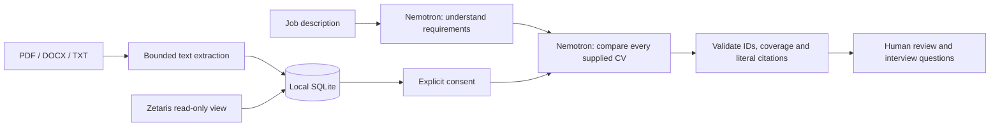

# TalentLens

**Find talent. See why.** TalentLens is a multilingual CV discovery workspace that connects job requirements with documented candidate experience. NVIDIA Nemotron interprets the role and CVs and proposes candidates with source citations. A recruiter verifies the evidence and decides the next step.

The application has no keyword compatibility engine, local candidate scoring, percentages or automatic hiring/rejection decisions.

## Quick start

Requires **Node.js 22.16 or later** and npm. Node 22 is recommended.

```powershell
cd hackaton
npm.cmd ci
if (-not (Test-Path .env)) { Copy-Item .env.example .env }
npm.cmd start
```

Open [TalentLens](http://127.0.0.1:4317). On Windows, you can also double-click `START-TALENTLENS.cmd`. Stop the server with Ctrl+C. The server binds to the local computer only. Node 22 may display an experimental warning for its built-in SQLite module.

Without API credentials, you can create roles, upload/view CVs and load three clearly fictional sample profiles. Sample content contains no fabricated AI results.

## Languages

The flag selector in the top bar switches between **English, Spanish, French and German**. English is the initial language. Your selection is remembered locally; `?lang=en`, `?lang=es`, `?lang=fr` and `?lang=de` also select a language explicitly.

Navigation, illustrations, forms, validation, API errors, connection states, sample content, dates and report export labels are localized. Nemotron is instructed to write every narrative field in the selected language. Existing reports can be translated through the active AI provider after explicit consent, and translations are cached locally. Translation preserves candidate IDs, ordering, recommendations, evidence statuses and original quotations.

Uploaded CVs, recruiter notes, company names and other user-provided content retain their original language. Source quotations are never translated: they remain verifiable against the exact document used for the report. The built-in fictional CVs and sample role have curated versions in all four languages.

## Connect NVIDIA Nemotron

For the hackathon, connect Nemotron **through Meterless Nightshift**. The [Official Rules updated on 22 October](https://hackathon.genai.works/resources?id=01a08ff1-54cc-709a-bfe7-6b34452b676b) require Nightshift as the primary AI provider and at least one working Meterless Engine. Cursor is optional; any AI coding tool is permitted.

1. Sign in to the [Nemotron 3.5 Super VL model page](https://build.nvidia.com/nvidia/nemotron-3.5-super-vl-120b-a12b) and choose **Generate API Key**.
2. If that button does not open the key dialog, use [NVIDIA NGC API Keys](https://org.ngc.nvidia.com/account/api-keys): sign in, generate a personal key and enable **NVIDIA Public API Endpoints**. Follow the [official NGC guide](https://docs.nvidia.com/ngc/latest/ngc-user-guide.html).
3. Save the key in **Nightshift → Providers**, select `nvidia/nemotron-3.5-super-vl-120b-a12b` if the runtime supports it, and verify which model actually handles a request.
4. Configure TalentLens with the Nightshift URL, runtime token and routing model below. Do not put the NVIDIA key in the application settings for the submitted workflow.

In **Connections**, test the active provider. Then open a role, consent to sending its documents and run an analysis. Endpoint availability and usage quotas depend on NVIDIA. `.env`, local data and dependencies are excluded from Git. The existing direct NVIDIA adapter is a development option and does not demonstrate the required Nightshift integration.

## Connect Meterless Nightshift

TalentLens implements the [official OpenAI-compatible Nightshift provider contract](https://github.com/Meterless/Meterless/blob/main/docs/agent-ready/add-meterless-provider.md): URL normalization, real bearer authentication, `meterless-app: talentlens`, `meterless-scope: user`, routing model IDs and a 180-second request timeout.

Install and start [Nightshift](https://www.meterless.ai/windows.html), configure its model lane to execute Nemotron, then set:

```dotenv
AI_PROVIDER=meterless
METERLESS_BASE_URL=http://127.0.0.1:8088/v1
METERLESS_RUNTIME_TOKEN=the-real-token-from-your-runtime
METERLESS_MODEL=meterless/deep
```

Nightshift stores its token at `<stateDir>/proxy-token`. The placeholder `rt-local` is rejected. Use a route listed by your runtime. Connection checks authenticate against `/v1/models`, distinguish unauthorized/offline/online states and send no CVs. A routing ID does not establish the underlying model: verify the actual Nemotron execution in Nightshift.

The provider adapter is implemented, but a live Nightshift run and a working Meterless Engine feature are still pending. Provider compatibility alone does not meet the Engine requirement.

## Connect Zetaris

The event's current [Zetaris setup repository](https://github.com/zetaris/getting-started) uses a local Docker installation with Lightning JDBC and REST access. Obtain the platform bundle, matching configuration and registry credentials from [Zetaris Cloud](https://cloud.enterprise.zetaris.com), then follow its [local installation guide](https://github.com/zetaris/getting-started/blob/main/docs/install/updated_zetaris_installation_guide.md). The platform distribution and evaluation entitlement are separate from the open-source recipes. On Windows, the guide uses WSL2 with Docker Desktop integration.

**Current limitation:** TalentLens's adapter below supports Trino only. It has not yet been adapted to or verified against the hackathon bundle's Lightning REST/JDBC interfaces. Do not describe the required Zetaris integration as complete. Local uploads do not demonstrate use of Zetaris as the application's data layer.

The read-only adapter supports a **Zetaris deployment exposing a Trino endpoint**, using the [Trino client protocol](https://trino.io/docs/current/develop/client-protocol.html). Configure a dedicated authorised view with these columns:

| Column | Content |
| --- | --- |
| `candidate_id` | Stable candidate identifier |
| `display_name` | Display name |
| `document_name` | CV filename |
| `cv_text` | Extracted CV text |

```dotenv
ZETARIS_URL=https://your-authorized-trino-endpoint
ZETARIS_USER=your-read-only-user
ZETARIS_TOKEN=your-token-if-required
ZETARIS_TABLE=hackathon.recruiting.candidates
```

Choose **Connections → Import from Zetaris**. The adapter uses fixed selected columns and `LIMIT 25`; it does not generate SQL or rank candidates. It pages responses and rejects cross-origin query redirects. The configured endpoint must support Trino and the selected authentication. The separate Zetaris SaaS REST API uses a different protocol and cannot be substituted without adapting the connector.

## Architecture



Analysis uses two model calls: requirement extraction and candidate comparison. The app validates output structure, coverage and exact source quotations, preserving the model’s recommendation order. Reports retain the job description and CV text they used. These checks provide traceability; they do not establish the truth of a CV or guarantee a correct, unbiased recommendation.

Roles, document text, source snapshots, reports, translations and human review states persist in `data/talentlens.sqlite`. The application automatically migrates the previous database filename without discarding records. Original upload binaries are not retained.

## Scope and limits

- Single-user local prototype; no authentication, tenant isolation or production hosting.
- Up to 25 CVs, 10 files per import, 5 MB per file, 40,000 characters per CV and 200,000 characters per analysis. Oversized inputs are rejected without silent truncation.
- Text-based PDFs up to 50 pages; scanned PDFs need OCR first. DOCX reads main text, tables, headers and footers, with archive/XML limits and no DTDs.
- Parsing uses separate child processes with a 128 MB JavaScript heap budget and a 20-second timeout. This is not an OS-level security sandbox or a hard native-memory cap.
- Model requests and report translations require explicit consent. Use fictional CVs for demonstrations and check the provider’s data terms before real CVs.
- Prompts instruct the model to ignore embedded document instructions and protected attributes. Prompt injection resistance and fairness require further evaluation.
- Real NVIDIA, Meterless and Zetaris integration still requires credentials and live verification; mock tests do not establish that integration.

## Validation

```powershell
npm.cmd run check
npm.cmd test
npm.cmd audit
```

Tests cover PDF/DOCX/TXT parsing, invalid inputs, origin controls, consent, evidence validation, locale completeness and parameters, selected model language, translation integrity/cache, localized exports, database migration, provider authentication and Zetaris paging boundaries. External services are mocked; no real CVs or paid model requests are used.

See [submission notes](docs/SUBMISSION.md) for project provenance, sponsor contribution and verified delivery status.
