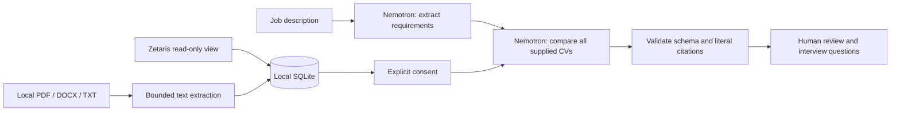

# Cora Atlas

An independent recruiting workspace inspired by the **idea** of Cora, written from scratch for Open Agent Hackathon 2026. No Cora product code, accounts, services, databases or real CVs are included.

Atlas turns a job description and an explicit collection of CVs into evidence-led recommendations. **Nemotron extracts the requirements, interprets the CVs and orders its recommendations.** Application code extracts document text, checks response structure and verifies literal citations. It contains no keyword compatibility engine, candidate scoring, percentages or automated hiring/rejection decisions.

## Run locally on Windows

Requires Node.js **22.16 or later** (Node 22 recommended) and npm.

```powershell
cd C:\Users\arian\Desktop\Proyectos\hackaton
npm.cmd ci
Copy-Item .env.example .env # only if .env does not already exist
npm.cmd start
```

Open [Cora Atlas](http://127.0.0.1:4317). Alternatively, double-click `ABRIR-CORA-ATLAS.cmd`. The server listens only on this computer. Stop it with Ctrl+C. Node 22 may print its built-in SQLite experimental warning.

The interface works without API credentials: use **Preparar ejemplo** to add three explicitly fictional CVs and a vacancy. Example data does **not** include fabricated AI results. To run an analysis, connect a provider, select a vacancy, provide consent and click **Analizar con Nemotron**.

## NVIDIA API key

1. Open the [Nemotron 3.5 Super VL model page](https://build.nvidia.com/nvidia/nemotron-3.5-super-vl-120b-a12b).
2. Sign in to NVIDIA and choose **Generate API Key**. Complete any account verification NVIDIA requires.
3. In the local `.env`, set `NVIDIA_API_KEY` to that key. Keep `AI_PROVIDER=nvidia`.
4. Restart the server. In **Conexiones**, check the provider, then run a sample analysis.

```dotenv
AI_PROVIDER=nvidia
NVIDIA_API_KEY=your-private-key
NVIDIA_MODEL=nvidia/nemotron-3.5-super-vl-120b-a12b
```

The model page showed a free prototype endpoint on 22 October 2026. Its availability and quotas are controlled by NVIDIA. The older Nemotron 3 Super free endpoint was marked deprecated. The API key authorizes NVIDIA API access; it is not an OpenAI API key. Never commit `.env` or paste the key into source code. `.env` is ignored by Git.

## Meterless integration

The backend implements the official [Nightshift OpenAI-compatible provider contract](https://github.com/Meterless/Meterless/blob/main/docs/agent-ready/add-meterless-provider.md): URL normalization, real bearer token, `meterless-app: cora-atlas`, `meterless-scope: user`, routing model IDs and a 180-second request timeout. Connection checks use authenticated `/v1/models` and distinguish missing credentials, unauthorized, offline and online.

Install and start Nightshift using the [official Meterless site](https://www.meterless.ai/windows.html). Configure its model fleet/lane to use Nemotron, then set:

```dotenv
AI_PROVIDER=meterless
METERLESS_BASE_URL=http://127.0.0.1:8088/v1
METERLESS_RUNTIME_TOKEN=the-real-token-from-your-runtime
METERLESS_MODEL=meterless/deep
```

The runtime token is stored by Nightshift under its `<stateDir>/proxy-token`. `rt-local` is not accepted. Use a routing ID listed by your runtime. `meterless/deep` is a route, not proof of the underlying model: capture the actual Nemotron execution in Nightshift for the submission. This project does not install Nightshift or claim H-MEM engine conformance. End-to-end testing with a real runtime remains pending.

## Zetaris integration

The connector supports a **Zetaris deployment exposing a Trino endpoint**, using the documented [Trino client protocol](https://trino.io/docs/current/develop/client-protocol.html). It reads a configured view, pages results and imports source-labelled CVs into the local workspace. It never asks a model to generate SQL. The query selects the four fixed columns below, with `LIMIT 25`; there is no application ranking.

```dotenv
ZETARIS_URL=https://your-authorized-trino-endpoint
ZETARIS_USER=your-read-only-user
ZETARIS_TOKEN=your-token-if-required
ZETARIS_TABLE=hackathon.recruiting.candidates
```

Prepare a read-only view with `candidate_id`, `display_name`, `document_name`, `cv_text`. Populate it through Zetaris from two clearly identified fictional recruiting data sources to demonstrate federation, then use **Conexiones → Importar desde Zetaris**. The chosen endpoint must support Trino and the selected bearer authentication. The separate Zetaris SaaS REST API uses another protocol; its URL is **not** interchangeable with the Trino endpoint. Confirm the access method offered by the hackathon workspace before configuring this adapter. Real Zetaris testing and federation evidence remain pending.

## Workflow and storage



Vacancies, document text, reports, report source snapshots and human review states persist in `data/atlas.sqlite`. Keys remain server-side. Data and reports are excluded from Git. Every analysis creates a new report; previous results retain the exact CV text they used. Reports can be downloaded as Markdown. A filename filter only filters the library display; it does not select, rank or score candidates for the AI.

The analysis makes two model calls: requirements first, then comparison of every supplied CV. The model must cover every requirement and candidate once. Responses containing unknown IDs, omitted candidates or unsupported literal quotes are rejected instead of shown as valid reports. These checks establish traceability, not the truth of a CV or the correctness of a recommendation. Prompts instruct the model to ignore document instructions and protected personal attributes; this is not a guarantee against prompt injection or bias. A recruiter reviews the output.

## Limits of this first version

- Single-user local prototype, not a hosted or production HR system; no authentication, tenant isolation or shared accounts.
- Up to 25 CVs, 10 files per import, 5 MB per file, 40,000 characters per CV, 200,000 characters per analysis. Limits cause explicit errors, never silent truncation.
- PDFs: text layer only, at most 50 pages. Scans need external OCR. DOCX: main text, tables, headers and footers; DTDs and oversized archives are rejected.
- Parsing runs in separate child processes with a 128 MB JavaScript heap budget and 20-second timeout. Native parser failures do not take down the web server. This is not an OS-level security sandbox or a hard cap on native library memory.
- No background indexing, automatic CV discovery, embeddings, retrieval scoring or automatic candidate rejection. No chat/memory engine is claimed.
- Original upload binaries are not retained; extracted text and report snapshots are retained locally. Provider requests require an explicit checkbox in the UI and consent flag on the API. Use synthetic data for the hackathon and check provider data terms before real CVs.
- Live NVIDIA, Meterless and Zetaris credentials are not included; successful mock tests do not prove live service integration.

## Validation

```powershell
npm.cmd run check
npm.cmd test
npm.cmd audit
```

Tests cover real PDF/DOCX/TXT parsing, invalid documents, cross-origin writes, explicit consent, a two-call model workflow, persisted reports/reviews, invented citations, missing candidates/requirements, Meterless authentication and Zetaris pagination/credential boundaries. External services are mocked; no paid API calls or real CVs are used.

See [HACKATHON.md](HACKATHON.md) for requirements, track rationale, pending submission work and source links. See [CURSOR-HANDOFF.md](CURSOR-HANDOFF.md) to continue in Cursor.
